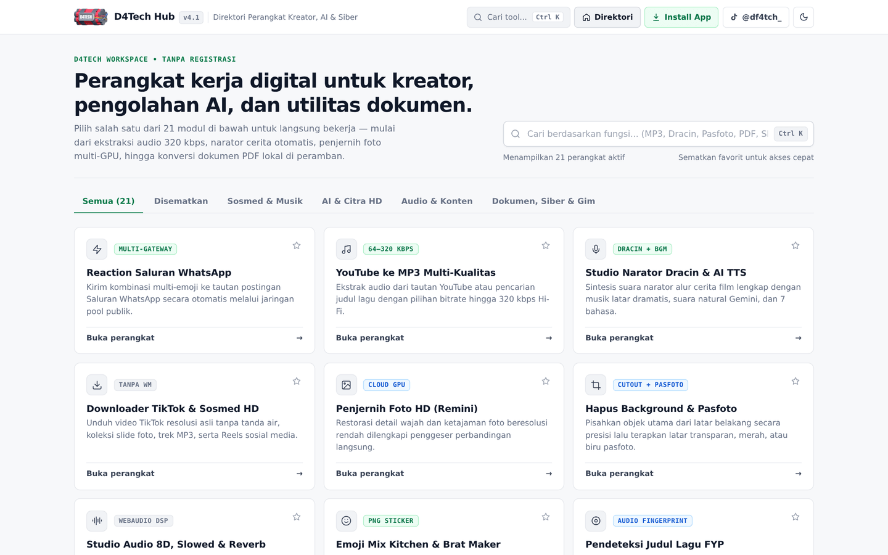
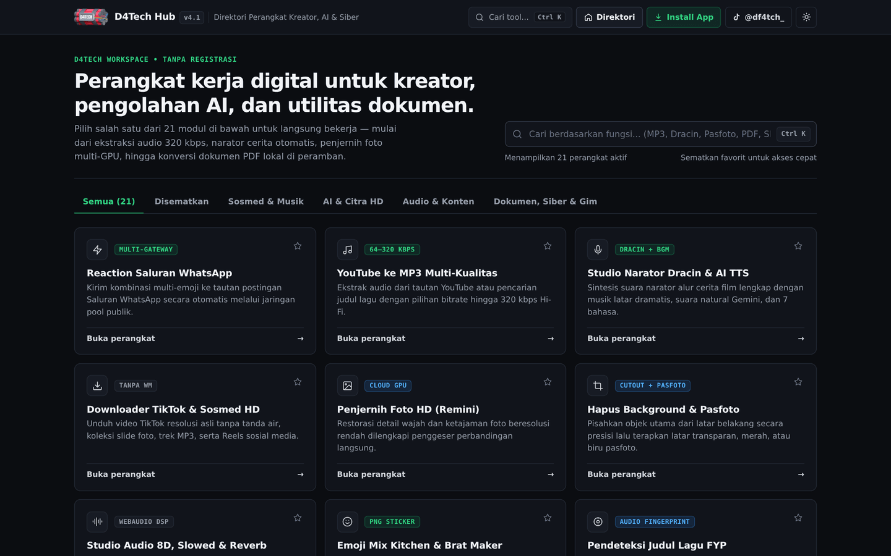
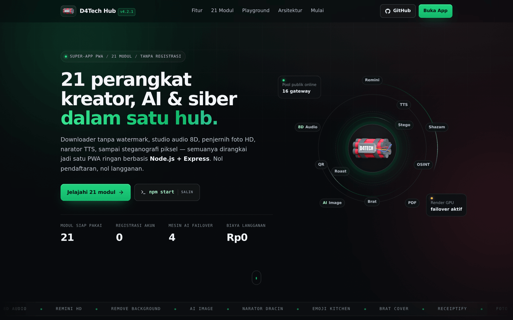
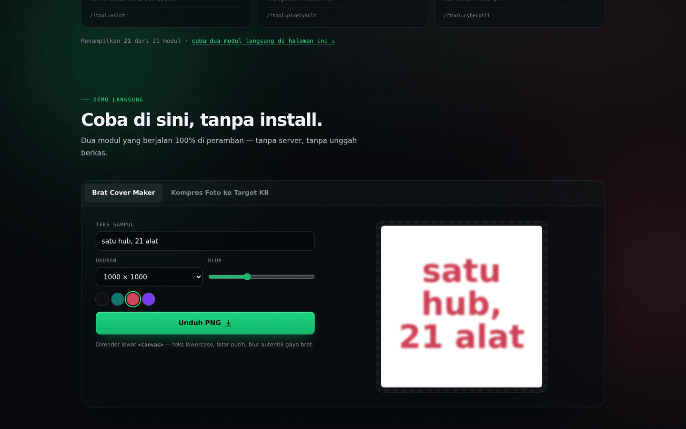
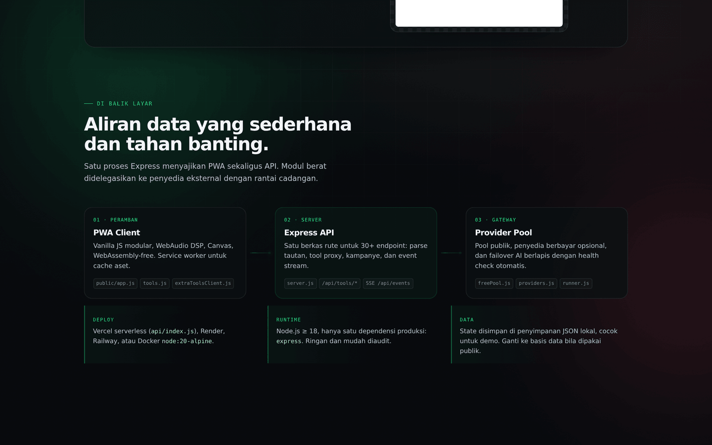

<div align="center">



<br />

**Super-App PWA berisi 21 perangkat kreator, AI, audio, dokumen, dan siber.**
Satu proses Node.js. Tanpa registrasi. Tanpa langganan.

[](https://nodejs.org)
[](https://expressjs.com)
[](#-pwa-installable)
[](#-21-modul)
[](#)
[](#-deploy)

[**Showcase**](https://daff4tech.github.io/daff4tech/) ·
[**Playground**](#-coba-di-browser) ·
[**Quick start**](#-quick-start) ·
[**TikTok @df4tch_**](https://www.tiktok.com/@df4tch_)

</div>

---

> **D4Tech Hub** menggabungkan hal-hal yang biasanya butuh 10 tab browser: downloader tanpa watermark, konverter MP3, penjernih foto, penghapus background, TTS narator, kompresor foto, PDF, steganografi, sampai OSINT. Semua dalam satu antarmuka yang rapi, cepat, dan bisa dipasang sebagai aplikasi.

## 📸 Tampilan

<table>
  <tr>
    <td width="50%">
      
      <br /><sub><b>Tema terang</b> — direktori 21 modul</sub>
    </td>
    <td width="50%">
      
      <br /><sub><b>Tema gelap</b> — kontras tinggi, tetap nyaman</sub>
    </td>
  </tr>
</table>

<div align="center">
  <br />
  <a href="https://daff4tech.github.io/daff4tech/">
    
  </a>
  <sub><i>Showcase interaktif di <code>docs/</code> — statis, tanpa build step, siap GitHub Pages.</i></sub>
</div>

---

## 📚 Daftar Isi

- [Tampilan](#-tampilan)
- [Kenapa D4Tech Hub](#-kenapa-d4tech-hub)
- [21 Modul](#-21-modul)
- [Coba di browser](#-coba-di-browser)
- [Quick start](#-quick-start)
- [Deploy](#-deploy)
- [Arsitektur](#-arsitektur)
- [API](#-api)
- [Struktur proyek](#-struktur-proyek)
- [Showcase & dokumentasi](#-showcase--dokumentasi)
- [Roadmap](#-roadmap)
- [Kredit](#-kredit)

---

## ✨ Kenapa D4Tech Hub

| | |
| --- | --- |
| **📲 PWA installable** <br /> Manifest, service worker, dan ikon maskable. Pasang ke layar utama Android, iOS, atau desktop. | **🔗 Deep-link per modul** <br /> Setiap perangkat punya alamat sendiri: `/?tool=emojimix`, `/?tool=8d`, `/?tool=dracin`. |
| **⚡ Alur kerja berantai** <br /> Hasil satu modul langsung dikirim ke modul berikutnya dalam satu klik. | **⭐ Pin & `Ctrl + K`** <br /> Sematkan favorit ke barisan teratas, cari modul lewat command palette. |
| **🛡️ Privasi lokal** <br /> Kompresor foto, gabung PDF, dan steganografi berjalan penuh di peramban. | **🔁 Multi-gateway failover** <br /> Empat mesin AI, pool publik, dan beberapa penyedia GPU saling menjadi cadangan. |

---

## 🧰 21 Modul

<details open>
<summary><b>🔥 Sosmed &amp; Musik</b> — 5 modul</summary>

| # | Modul | Fungsi |
| :-: | --- | --- |
| 1 | **Reaction Saluran WhatsApp** | Kirim multi-emoji reaction ke postingan Saluran WA lewat pool gateway publik. |
| 2 | **YouTube ke MP3** | Konversi tautan atau pencarian lagu ke MP3 64–320 kbps. |
| 3 | **Downloader TikTok & Sosmed HD** | Video tanpa watermark, slide foto, MP3, dan Reels. |
| 4 | **Pendeteksi Judul Lagu FYP** | Audio fingerprint untuk melacak judul, artis, dan album. |
| 5 | **Analitik TikTok & Saluran WA** | Statistik pengikut, total suka, bio, dan avatar resolusi asli. |

</details>

<details open>
<summary><b>🤖 AI &amp; Citra HD</b> — 5 modul</summary>

| # | Modul | Fungsi |
| :-: | --- | --- |
| 6 | **AI Penjernih Foto HD (Remini)** | Restorasi wajah & ketajaman foto buram, dengan slider before/after. |
| 7 | **Hapus Background & Pasfoto** | Cutout otomatis + latar transparan, merah, atau biru pasfoto. |
| 8 | **AI Image Generator HD** | Text-to-image rasio 1:1, 9:16, dan 16:9. |
| 9 | **Ringkas YouTube & Thumbnail 4K** | Rangkuman Bahasa Indonesia, transkrip penuh, sampul MaxRes. |
| 10 | **AI Roaster & Skor Aura TikTok** | Komentar komedi AI + ekspor kartu skor aura PNG. |

</details>

<details open>
<summary><b>🎧 Audio &amp; Kreator Konten</b> — 5 modul</summary>

| # | Modul | Fungsi |
| :-: | --- | --- |
| 11 | **Studio Audio 8D / Slowed + Reverb** | Efek spasial live di peramban + visualizer neon + ekspor WAV. |
| 12 | **Narator Dracin & AI TTS** | Suara narator viral, BGM otomatis, 7 bahasa, ekspor MP3. |
| 13 | **Emoji Mix Kitchen & Brat Maker** | Gabung dua emoji jadi stiker PNG + generator sampul teks Brat. |
| 14 | **Stiker Komentar TikTok & Mockup Chat** | Overlay komentar transparan, kutipan WA, chat iPhone. |
| 15 | **Struk Thermal & Kartu Lirik** | Receiptify ber-barcode + Spotify lyrics card. |

</details>

<details open>
<summary><b>🕵️ Dokumen, Siber &amp; Gim</b> — 6 modul</summary>

| # | Modul | Fungsi |
| :-: | --- | --- |
| 16 | **Kompresor Foto Target KB** | Perkecil foto tepat di bawah `<100 KB`, `<200 KB`, `<500 KB` + konversi JPG/WebP/PNG. |
| 17 | **Gabung Foto ke PDF** | Susun beberapa foto menjadi PDF A4 rapi, 100% di perangkat. |
| 18 | **Kalkulator Target Winrate MLBB** | Hitung win streak yang dibutuhkan menuju target WR. |
| 19 | **Pencari Jejak Username (OSINT)** | Pindai satu username di 16 platform secara paralel. |
| 20 | **Pixel Vault (Steganografi)** | Sembunyikan & enkripsi pesan di bit piksel PNG. |
| 21 | **Inspektur Tautan, Shortlink & QR** | Bongkar redirect mencurigakan + GeoIP, ringkas URL, QR berlogo. |

</details>

---

## 🎮 Coba di browser

Halaman showcase (`docs/`) berisi dua modul yang berjalan **tanpa server** dan bisa dicoba langsung:

- **Brat Cover Maker** — ketik teks, atur blur & warna, unduh PNG 1000×1000.
- **Kompresor foto ke target KB** — jatuhkan foto, pilih target `<100 KB`/`<200 KB`, lihat penghematan ukuran, unduh hasilnya.

<div align="center">
  
</div>

```bash
# jalankan showcase secara lokal
npx serve docs      # atau: python3 -m http.server 4173 --directory docs
```

Showcase juga otomatis tersedia di aplikasi pada rute **`/showcase`**.

---

## 🚀 Quick start

```bash
git clone https://github.com/daff4tech/daff4tech.git
cd daff4tech
npm install
npm start
```

Buka **http://localhost:3000** — tidak ada konfigurasi wajib, tidak ada API key yang harus diisi untuk mulai memakai modul lokal.

| Variabel | Default | Keterangan |
| --- | --- | --- |
| `PORT` | `3000` | Port server Express. |

> **Butuh Node.js ≥ 18** (memanfaatkan `fetch` bawaan). Satu-satunya dependensi produksi adalah `express`.

---

## ☁️ Deploy

<div align="center">

[](https://vercel.com/new/clone?repository-url=https://github.com/daff4tech/daff4tech)
[](https://render.com/deploy?repo=https://github.com/daff4tech/daff4tech)

</div>

<details>
<summary><b>Docker</b></summary>

```bash
docker build -t d4tech-hub .
docker run -p 3000:3000 d4tech-hub
```

</details>

<details>
<summary><b>Vercel (serverless)</b></summary>

`vercel.json` sudah mengarahkan seluruh trafik ke `api/index.js`, yang mengekspor instance Express. Tidak perlu konfigurasi tambahan.

</details>

<details>
<summary><b>Render (blueprint)</b></summary>

`render.yaml` menyediakan layanan web Node gratis dengan `npm install` + `npm start`.

</details>

---

## 🏗 Arsitektur

```text
┌──────────────────────────────────────────────────────────────────────┐
│  PWA CLIENT  ·  public/                                              │
│  app.js (shell, routing, deep-link)                                  │
│  tools.js + extraToolsClient.js  ← WebAudio, Canvas, Clipboard        │
│  sw.js + manifest.json           ← installable & cache aset          │
└───────────────────────────────┬──────────────────────────────────────┘
                                │  JSON / multipart  (≤ 4 MB)
┌───────────────────────────────▼──────────────────────────────────────┐
│  EXPRESS API  ·  server.js (satu berkas rute, 30+ endpoint)           │
│  /api/tools/*   /api/campaigns   /api/providers   /api/events (SSE)   │
└───────────────────────────────┬──────────────────────────────────────┘
                                │
┌───────────────────────────────▼──────────────────────────────────────┐
│  MODUL INTI  ·  src/                                                 │
│  providers.js  → pool publik + penyedia berbayar + health check       │
│  freePool.js   → gateway publik & rotasi emoji                        │
│  toolsHub.js   → downloader, MP3, stalker, summary, shazam            │
│  extraTools.js → AI teks, Remini, TTS, OSINT, link/QR, lirik          │
│  runner.js     → orkestrasi kampanye & log realtime                    │
└──────────────────────────────────────────────────────────────────────┘
```

Prinsip desainnya sederhana: **browser mengerjakan apa pun yang bisa dikerjakan lokal** (kompresi, PDF, stego, audio DSP), dan **server hanya menjadi jembatan** untuk hal yang benar-benar butuh jaringan.

<div align="center">
  
</div>

---

## 🔌 API

<details>
<summary><b>Endpoint publik (ringkas)</b></summary>

| Method | Endpoint | Fungsi |
| --- | --- | --- |
| `GET` | `/api/state` | Bootstrap state: provider aktif, kampanye, log. |
| `GET` | `/api/events` | Server-Sent Events untuk log realtime. |
| `POST` | `/api/parse-link` | Validasi & pratinjau tautan postingan Saluran WA. |
| `POST` | `/api/tools/downloader` | Ekstraksi media TikTok / Reels tanpa watermark. |
| `POST` | `/api/tools/ytmp3` | Konversi audio YouTube multi-bitrate. |
| `POST` | `/api/tools/yt-search` | Pencarian video/lagu YouTube. |
| `POST` | `/api/tools/yt-summary` | Rangkuman, transkrip, dan thumbnail 4K. |
| `POST` | `/api/tools/remini` | Peningkatan kualitas foto (multi-GPU). |
| `POST` | `/api/tools/removebg` | Penghapusan latar belakang. |
| `POST` | `/api/tools/ai-image` | Text-to-image. |
| `POST` | `/api/tools/tts` | Sintesis suara narator multi-bahasa. |
| `POST` | `/api/tools/shazam` | Identifikasi lagu dari potongan audio. |
| `POST` | `/api/tools/osint` | Pemindaian username di 16 platform. |
| `POST` | `/api/tools/scan-link` | Unshorten + GeoIP server tujuan. |
| `POST` | `/api/tools/shortlink` | Pemendek URL. |
| `POST` | `/api/tools/qr-base` | Generator QR code. |
| `POST` | `/api/tools/emojimix` | Emoji Kitchen. |
| `POST` | `/api/tools/lyrics` | Pencarian lirik untuk kartu tipografi. |

</details>

**Catatan etika:** modul siber (OSINT, inspektur tautan) hanya memakai sumber publik. Gunakan dengan tanggung jawab dan patuhi ketentuan layanan masing-masing platform.

---

## 📁 Struktur proyek

```text
.
├── api/index.js            # entry serverless Vercel
├── server.js               # Express app + seluruh rute API
├── src/                    # modul server (provider, pool, tools, store)
├── public/                 # PWA client (HTML, CSS, JS, manifest, SW)
├── docs/                   # showcase statis untuk GitHub Pages
├── assets/                 # banner & social preview
├── Dockerfile · render.yaml · vercel.json
└── package.json
```

---

## 🖼 Showcase & dokumentasi

Halaman showcase di `docs/` dibuat tanpa build step — cukup buka `docs/index.html`.

- **GitHub Pages:** workflow `.github/workflows/pages.yml` sudah disiapkan. Aktifkan **Settings → Pages → Source: GitHub Actions**, lalu setiap push ke `main` akan menerbitkan `docs/`.
- **Tautkan aplikasi:** karena showcase adalah situs terpisah, atur URL deployment-mu di bagian atas `docs/app.js`:

```js
window.D4TECH_APP_URL = 'https://nama-app-mu.vercel.app';
```

Tanpa konfigurasi itu, tombol modul akan menyalin deep-link `/?tool=<slug>` ke clipboard.

**Social preview repo:** unggah `assets/social-preview.png` (1280×640) lewat *Settings → General → Social preview* agar tautan repo tampil rapi saat dibagikan.

---

## 🗺 Roadmap

- [ ] Penyimpanan persisten (SQLite/Postgres) sebagai opsi pengganti state JSON.
- [ ] Mode offline penuh untuk modul lokal lewat service worker.
- [ ] Pustaka preset alur berantai yang bisa dibagikan lewat tautan.
- [ ] Tema terang/gelap yang tersinkron antar-perangkat.
- [ ] Uji otomatis untuk parser tautan dan endpoint kritis.

---

## 🙌 Kredit

Dibuat dan dirawat oleh **[@df4tch_](https://www.tiktok.com/@df4tch_)**.
Modul AI memakai gateway publik dan penyedia pihak ketiga; setiap merek (WhatsApp, TikTok, YouTube, Google, Remini, MLBB) adalah milik pemegang haknya masing-masing.

<div align="center">
<br />
<sub>Kalau repo ini berguna, beri ⭐ supaya orang lain menemukannya.</sub>
</div>
